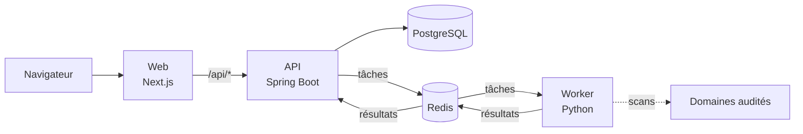

# Vigie

[](https://github.com/YATAB1/vigie/actions/workflows/ci.yml)

Plateforme de surveillance de sécurité web. Un utilisateur ajoute un domaine
dont il prouve la propriété, et Vigie audite sa configuration en continu :
en-têtes HTTP, TLS, DNS courriel. Chaque audit produit un score et des
recommandations de correction.

> **État du projet :** en développement actif. Voir la [feuille de route](#feuille-de-route)
> pour ce qui est livré et ce qui s'en vient.

## Architecture



| Service | Rôle | Techno |
|---|---|---|
| `web` | Interface utilisateur. Relaie `/api/*` vers l'API, donc aucune configuration CORS. | Next.js 16, TypeScript |
| `api` | Comptes, domaines, résultats. Seul service qui écrit dans la base. | Java 21, Spring Boot 4 |
| `worker` | Exécute les scans. Ne reçoit que des tâches, ne touche jamais à la base. | Python 3.13 |
| `postgres` | Données persistantes. | PostgreSQL 17 |
| `redis` | File de tâches entre l'API et le worker. | Redis 7 |

### Pourquoi un worker séparé

Un scan prend plusieurs secondes et contacte des serveurs qu'on ne contrôle pas.
Le sortir de l'API apporte trois choses :

- **L'API reste rapide** : elle dépose une tâche dans Redis et répond tout de suite.
- **Isolation** : le code qui lit des réponses réseau non fiables tourne sans
  accès à la base de données ni aux secrets de l'API.
- **Mise à l'échelle** : on ajoute des workers sans toucher à l'API.

## Démarrage rapide

Prérequis : Docker et Docker Compose.

```bash
cp .env.example .env
openssl rand -base64 48   # coller le résultat dans VIGIE_JWT_SECRET, et changer POSTGRES_PASSWORD
docker compose up --build
```

Sous Windows, `openssl` est fourni avec Git : lancer la commande dans Git Bash.

- Interface : http://localhost:3000
- API : http://localhost:8080/api/v1/status
- Santé de l'API : http://localhost:8080/actuator/health

Tous les ports sont liés à `127.0.0.1` : rien n'est exposé sur le réseau local.

## Développement

Chaque service se lance et se teste indépendamment.

```bash
# API (les tests utilisent une base H2 en mémoire : rien à installer)
cd api && mvn verify

# Worker
cd worker
python -m venv .venv && source .venv/bin/activate
pip install -e ".[dev]"
ruff check . && pytest

# Web
cd web
npm ci
npm run lint && npm run typecheck && npm test
```

La CI (GitHub Actions) exécute ces mêmes commandes à chaque push, puis
construit les trois images Docker.

## Authentification

| Méthode | Route | Rôle |
|---|---|---|
| `POST` | `/api/v1/auth/register` | Crée un compte et ouvre une session |
| `POST` | `/api/v1/auth/login` | Ouvre une session |
| `POST` | `/api/v1/auth/refresh` | Renouvelle la session |
| `POST` | `/api/v1/auth/logout` | Ferme la session |
| `GET` | `/api/v1/me` | Compte de l'utilisateur connecté |
| `GET` | `/api/v1/admin/users` | Liste des comptes (administrateur seulement) |

Une session repose sur deux jetons, transmis uniquement par cookies :

- **Jeton d'accès** : JWT signé (HS256), valide 15 minutes. L'API le vérifie
  sans interroger la base.
- **Jeton de renouvellement** : valeur aléatoire de 256 bits, valide 7 jours,
  à usage unique. Seul son hachage SHA-256 est stocké.

Choix de sécurité :

- **Mots de passe** hachés avec bcrypt (coût 12), 12 caractères minimum.
- **Cookies `HttpOnly`** : JavaScript ne peut pas lire les jetons, donc une
  faille XSS ne permet pas de voler une session.
- **Cookies `SameSite=Strict`** : le navigateur ne les joint pas aux requêtes
  venant d'un autre site, ce qui bloque les attaques CSRF.
- **Rotation des jetons de renouvellement** : chaque renouvellement invalide
  le jeton utilisé. Si un jeton déjà utilisé est présenté de nouveau, il a été
  volé ou rejoué : toutes les sessions du compte sont révoquées.
- **Réponse identique** pour un courriel inconnu et un mauvais mot de passe,
  avec le même temps de calcul, pour ne pas révéler quels comptes existent.
- **Refus par défaut** : toute nouvelle route exige une session, sauf si elle
  est explicitement déclarée publique.
- **Aucune route ne peut attribuer le rôle administrateur.** Le premier
  administrateur est créé au démarrage à partir de variables d'environnement.

Limites connues, prévues à l'étape de durcissement : pas encore de limitation
du nombre de tentatives de connexion, et un changement de rôle prend jusqu'à
15 minutes à s'appliquer (durée de vie du jeton d'accès). Les tests de l'API
tournent sur H2 en mode PostgreSQL ; la migration SQL est validée séparément
sur PostgreSQL.

## Domaines et scans

| Méthode | Route | Rôle |
|---|---|---|
| `POST` | `/api/v1/domains` | Ajoute un domaine et renvoie le défi DNS à publier |
| `GET` | `/api/v1/domains` | Liste mes domaines |
| `POST` | `/api/v1/domains/{id}/verify` | Lance la vérification de propriété |
| `DELETE` | `/api/v1/domains/{id}` | Supprime un domaine et ses rapports |
| `POST` | `/api/v1/domains/{id}/scans` | Lance un scan (domaine vérifié seulement) |
| `GET` | `/api/v1/domains/{id}/scans` | Historique des scans |
| `GET` | `/api/v1/scans/{id}` | Rapport détaillé |

### Preuve de propriété

Vigie ne scanne que les domaines dont l'utilisateur a prouvé la propriété.
À l'ajout d'un domaine, l'API génère un jeton aléatoire et demande de publier
un enregistrement DNS :

```
_vigie-challenge.exemple.com.  TXT  "vigie-verification=<jeton>"
```

Seul quelqu'un qui contrôle la zone DNS peut le faire. Le worker lit
l'enregistrement, mais c'est l'API qui décide : elle compare la valeur au jeton
attendu. Deux utilisateurs qui réclament le même domaine reçoivent des jetons
différents, donc l'un ne peut pas profiter de la preuve de l'autre.

### Vérifications effectuées

| Catégorie | Vérifications |
|---|---|
| TLS | Connexion HTTPS, validité du certificat, date d'expiration, version négociée |
| En-têtes | HSTS, Content-Security-Policy, X-Content-Type-Options, clickjacking, Referrer-Policy, Permissions-Policy, divulgation de versions, attributs des cookies |
| Transport | Redirection de HTTP vers HTTPS |
| Courriel | SPF, DMARC |

Chaque vérification échouée a une gravité et une recommandation de correction.
Le score part de 100 et perd 40 points par problème critique, 20 par problème
élevé, 10 par problème moyen et 4 par problème faible. La note va de A à F.

### Protection contre le SSRF

Un scanner se connecte à une adresse choisie par un utilisateur. Sans
précaution, on pourrait le pointer vers un service interne (la base de données,
l'adresse de métadonnées d'un fournisseur infonuagique) et lire la réponse dans
le rapport. Le worker applique donc ces règles :

- **Adresses publiques seulement.** Le nom est résolu une fois, et le scan est
  refusé si une seule des adresses est privée, locale ou réservée.
- **Connexion à l'adresse validée.** Le worker se connecte à l'adresse IP
  vérifiée, pas au nom, pour qu'une seconde réponse DNS ne puisse pas le
  détourner (DNS rebinding).
- **Aucune redirection vers un autre hôte.** Seules les redirections internes
  au domaine vérifié sont suivies, trois au maximum.
- **Ports fixes** (443 et 80) et lecture des en-têtes uniquement, jamais du
  contenu des pages.
- **Double validation** du nom de domaine, par l'API puis par le worker.

L'API, elle, ne contacte jamais le domaine d'un utilisateur : tout le trafic
sortant passe par le worker, qui n'a accès ni à la base ni aux secrets.

Les résultats renvoyés par le worker ne sont appliqués que s'ils correspondent
à une tâche que l'API a créée et qui est encore en attente. Un message forgé ou
rejoué est ignoré.

## Contrat de messages

L'API et le worker échangent du JSON par deux listes Redis.

Tâche, déposée dans `vigie:jobs` :

```json
{ "id": "7f3c…", "type": "ping", "payload": {} }
```

Résultat, déposé dans `vigie:results` :

```json
{
  "job_id": "7f3c…",
  "type": "ping",
  "status": "succeeded",
  "data": { "pong": true },
  "error": null,
  "finished_at": "2026-11-13T17:37:04Z"
}
```

Types de tâches : `scan` (analyse complète d'un domaine), `dns_txt` (lecture
d'enregistrements TXT pour la preuve de propriété) et `ping`.

Un message illisible ou qui ne respecte pas le schéma est déplacé dans
`vigie:jobs:dead` au lieu d'être perdu. Une tâche dont le traitement échoue
produit un résultat `failed` : une erreur ne fait jamais tomber le worker.

## Feuille de route

- [x] Structure du dépôt, Docker Compose, CI
- [x] Squelette des trois services, file de tâches fonctionnelle (`ping`)
- [x] Comptes : inscription, connexion, rôles
- [x] Domaines, avec preuve de propriété par enregistrement DNS
- [x] Scans : en-têtes HTTP, TLS, SPF/DMARC, calcul du score
- [ ] Tableau de bord et historique
- [ ] Scans planifiés et alertes
- [ ] Durcissement : limitation des tentatives de connexion, tests sur PostgreSQL,
      détection de TLS 1.0/1.1, revérification périodique de la propriété
- [ ] Déploiement sur Azure

## Structure

```
api/       API REST (Spring Boot)
worker/    Worker de scan (Python)
web/       Interface (Next.js)
.github/   Intégration continue
```
