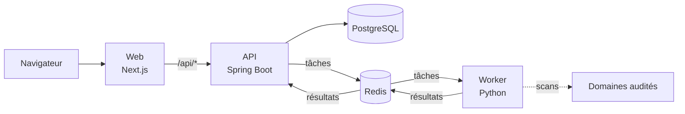

# Vigie

[](https://github.com/YATAB1/vigie/actions/workflows/ci.yml)

Plateforme de surveillance de sécurité web. Un utilisateur ajoute un domaine
dont il prouve la propriété, et Vigie audite sa configuration en continu :
en-têtes HTTP, TLS, DNS courriel. Chaque audit produit un score et des
recommandations de correction.

> **État du projet :** en développement actif. Voir la [feuille de route](#feuille-de-route)
> pour ce qui est livré et ce qui s'en vient.

## Architecture



| Service | Rôle | Techno |
|---|---|---|
| `web` | Interface utilisateur. Relaie `/api/*` vers l'API, donc aucune configuration CORS. | Next.js 16, TypeScript |
| `api` | Comptes, domaines, résultats. Seul service qui écrit dans la base. | Java 21, Spring Boot 4 |
| `worker` | Exécute les scans. Ne reçoit que des tâches, ne touche jamais à la base. | Python 3.13 |
| `postgres` | Données persistantes. | PostgreSQL 17 |
| `redis` | File de tâches entre l'API et le worker. | Redis 7 |

### Pourquoi un worker séparé

Un scan prend plusieurs secondes et contacte des serveurs qu'on ne contrôle pas.
Le sortir de l'API apporte trois choses :

- **L'API reste rapide** : elle dépose une tâche dans Redis et répond tout de suite.
- **Isolation** : le code qui lit des réponses réseau non fiables tourne sans
  accès à la base de données ni aux secrets de l'API.
- **Mise à l'échelle** : on ajoute des workers sans toucher à l'API.

## Démarrage rapide

Prérequis : Docker et Docker Compose.

```bash
cp .env.example .env      # puis changer POSTGRES_PASSWORD
docker compose up --build
```

- Interface : http://localhost:3000
- API : http://localhost:8080/api/v1/status
- Santé de l'API : http://localhost:8080/actuator/health

Tous les ports sont liés à `127.0.0.1` : rien n'est exposé sur le réseau local.

## Développement

Chaque service se lance et se teste indépendamment.

```bash
# API
cd api && mvn verify

# Worker
cd worker
python -m venv .venv && source .venv/bin/activate
pip install -e ".[dev]"
ruff check . && pytest

# Web
cd web
npm ci
npm run lint && npm run typecheck && npm test
```

La CI (GitHub Actions) exécute ces mêmes commandes à chaque push, puis
construit les trois images Docker.

## Contrat de messages

L'API et le worker échangent du JSON par deux listes Redis.

Tâche, déposée dans `vigie:jobs` :

```json
{ "id": "7f3c…", "type": "ping", "payload": {} }
```

Résultat, déposé dans `vigie:results` :

```json
{
  "job_id": "7f3c…",
  "type": "ping",
  "status": "succeeded",
  "data": { "pong": true },
  "error": null,
  "finished_at": "2026-11-13T17:37:04Z"
}
```

Un message illisible ou qui ne respecte pas le schéma est déplacé dans
`vigie:jobs:dead` au lieu d'être perdu. Une tâche dont le traitement échoue
produit un résultat `failed` : une erreur ne fait jamais tomber le worker.

## Feuille de route

- [x] Structure du dépôt, Docker Compose, CI
- [x] Squelette des trois services, file de tâches fonctionnelle (`ping`)
- [ ] Comptes : inscription, connexion, rôles
- [ ] Domaines, avec preuve de propriété par enregistrement DNS
- [ ] Scans : en-têtes HTTP, TLS, SPF/DMARC, calcul du score
- [ ] Tableau de bord et historique
- [ ] Scans planifiés et alertes
- [ ] Déploiement sur Azure

## Structure

```
api/       API REST (Spring Boot)
worker/    Worker de scan (Python)
web/       Interface (Next.js)
.github/   Intégration continue
```
